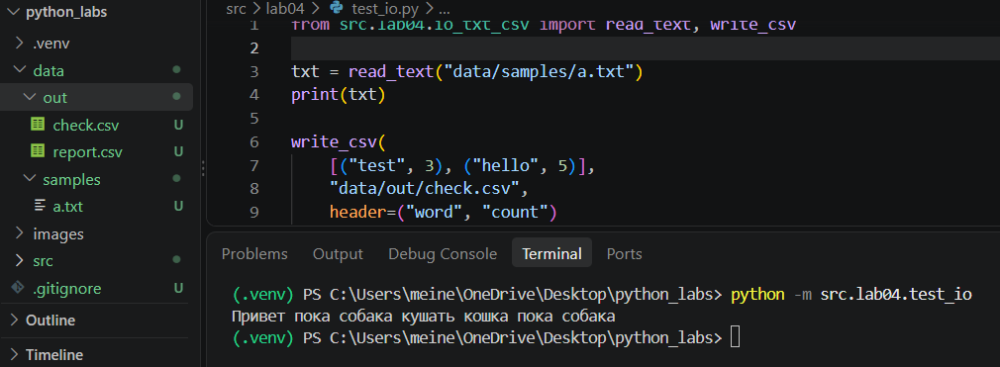
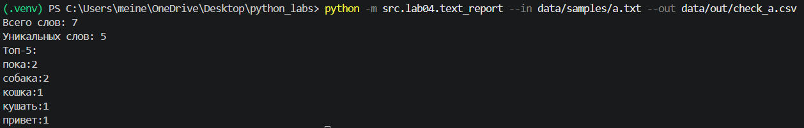
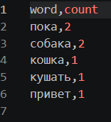
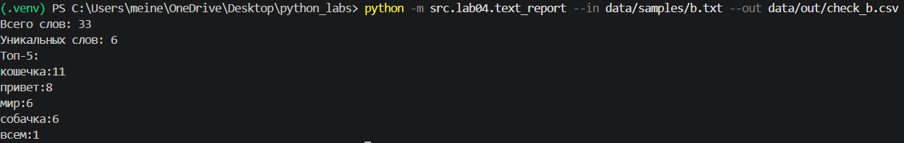
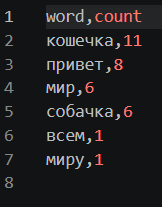

# ЛР4 — Файлы: TXT/CSV и отчёты по текстовой статистике

## Задание А
### read_text

``` python
def read_text(path: str | Path, encoding: str = "utf-8") -> str:
    p = Path(path)
    return p.read_text(encoding=encoding)
```
Читает содержимое текстового файла и возвращает его в виде строки. По умолчанию используется кодировка UTF-8. При необходимости можно указать другую кодировку, например cp1251.
### write_csv
``` python
def write_csv(rows: Iterable[Sequence], path: str | Path,
              header: tuple[str, ...] | None = None) -> None:
    p = Path(path)
    rows = list(rows)
    with p.open("w", newline="", encoding="utf-8") as f:
        w = csv.writer(f)
        if header is not None:
            w.writerow(header)
        for r in rows:
            w.writerow(r)
```
Записывает данные в CSV-файл с разделителем-запятой. При передаче заголовка он записывается первой строкой. Файл создаётся заново или перезаписывается, если уже существует.

### мини тест:



## Задание B 

```python 
def main() -> None:
    parser = argparse.ArgumentParser(description="Парсер лабы")
    parser.add_argument("--in", dest="input", help="Путь к файлу", required=True)
    parser.add_argument("--out", help="Путь к отчёту", required=True)
    parser.add_argument("--encoding", default="utf-8", help="Кодировка")
    args = parser.parse_args()
```
Создание парсера

```python
    try:
        path = Path(args.input)
        out_path = Path(args.out)
        text = normalize(read_text(path=path, encoding=args.encoding))
        tokens=tokenize(text)
        counts = count_freq(tokens)
        rows = top_n(counts, len(counts))
        write_csv(rows=rows, path=out_path, header=('word', 'count'))
        print(f'Всего слов: {len(tokens)}')
        print(f'Уникальных слов: {len(counts)}')
        print(f'Топ-5:')
        for word, count in top_n(counts, n=5):
            print(f'{word}:{count}')
```
Попытка прочитать и обработать файл, создать csv и вывезди мини отчет

```python 
except FileNotFoundError as error:
        print(f'Файл не найден: {error.filename}')
    except (UnicodeDecodeError, LookupError) as error:
        print(f'Ошибка кодировки')
    except error as error:
        print(f'Ошибка: {error}')
```
Выводим ошибки при ошибках, чтобы программа не упала 

## примеры запуска 
### Пример а
### Ввод:
    Привет пока собака кушать кошка пока собака
### Вывод в консоли:

### Вывод в csv:


### Пример б
### Ввод:
    Привет Привет привет привет мир!!!! всем мир, миру мир, привет мир мир мир, привет собачка, привет кошечка, собачка, собачка собачка 
    кошечка кошечка кошечка кошечка кошечка кошечка кошечка кошечка кошечка кошечка собачка собачка привет 
### Вывод в консоли:

### Вывод в CSV:
