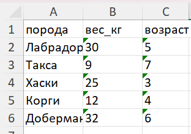

# ЛР5 — JSON и конвертации
## Задание А — JSON ↔ CSV
### Сначала рассмитрим JSON -> CSV
``` python
def json_to_csv(json_path: str, csv_path: str) -> None:

    if Path(json_path).suffix.lower() != ".json":
        raise ValueError('Входной файл должен быть json')
    if Path(csv_path).suffix.lower() != ".csv":
        raise ValueError("Выходной файл должен быть csv")
```
создание функции и исключение ошибок
``` python
    try:
        with open(json_path, encoding="UTF-8") as file_in:
            records = json.load(file_in)

    except json.JSONDecodeError:
        raise ValueError('пустой файл или неподдерживаемая структура')

    if not isinstance(records, list) or not records or not all(isinstance(item, dict) for item in records):
        raise ValueError('пустой json или не тот формат')
```
Открываем файл и читаем его, исключаем ошибки
``` python
    header = set()
    for item in records:
        for key in item:
            header.add(key)
    
    header = sorted(header)

    if not header:
        raise ValueError('не содержить данных для csv')
    if any(not key.strip() for key in header):
        raise ValueError('пустое назваание')
```
создание шапки таблицы, расстоновка столбцов в алфавитном порядке для удобства, исключение ошибок
```python    
    rows = []
    for item in records:
        row = []
        for key in header:
            row.append(item.get(key, ""))
        rows.append(row)
```
записываем в строки
```python    
    with open(csv_path, 'w', encoding="UTF-8", newline="") as file_out:
        writer = csv.DictWriter(file_out, fieldnames=header)
        writer.writeheader()
        for row in rows:
            writer.writerow(dict(zip(header, row)))
```
создаем или перезаписываем файл с csv версией, записываем шапку и строки

### Проверочка 
исходный файл
``` json
[
  {"name": "Alice", "age": 22},
  {"name": "Bob", "age": 25}
]
```
итоговый файл
```
age,name
22,Alice
25,Bob
```

### Теперь посмотрим на CSV -> JSON
```python
def csv_to_json(csv_path: str, json_path: str) -> None:

    if Path(csv_path).suffix.lower() != ".csv":
        raise ValueError('Входной файл должен быть csv')
    if Path(json_path).suffix.lower() != ".json":
         raise ValueError("Выходной файл должен быть json")

    try:
        with open(csv_path, encoding="UTF-8") as file_in:
            reader = csv.DictReader(file_in)
            records = list(reader)
    
    except(csv.Error, UnicodeDecodeError):
        raise ValueError('файл не читается')

    if not reader.fieldnames:
        raise ValueError('нет заголовка')
    if not records or not all(isinstance(item, dict) for item in records):
        raise ValueError('файл пуст или не тот формат')
    
    if any(not name.strip() for name in reader.fieldnames):
        raise ValueError("пустое название колонки")

    if len(set(reader.fieldnames)) != len(reader.fieldnames):
        raise ValueError("названия колонок не должны повторяться")
```
аналогично с предыдущей функцией читаем файл и исключаем ошибки
``` python
    with open(json_path, 'w', encoding="UTF-8") as file_out:
        json.dump(records, file_out, ensure_ascii=False, indent=2)
```
Создаем или перезаписываем файл и переносим с помощью json.dump в json файл

### Проверочка 
Исходный файл
```
name,age,city
Alice,22,SPB
Bob,25,Moscow
```
выхоной файл
``` json
[
  {
    "name": "Alice",
    "age": "22",
    "city": "SPB"
  },
  {
    "name": "Bob",
    "age": "25",
    "city": "Moscow"
  }
]
```

## Задание B — CSV → XLSX

```python
def csv_to_xlsx(csv_path: str, xlsx_path: str) -> None:

    if Path(csv_path).suffix.lower() != '.csv':
        raise ValueError('Входной файл должен быть csv')
    if Path(xlsx_path).suffix.lower() != '.xlsx':
        raise ValueError('Выходной файл должен быть xlsx')

    try:
        with open(csv_path, encoding="UTF-8", newline="") as file_in:
            reader = csv.reader(file_in)
            rows = list(reader)
    except (csv.Error, UnicodeDecodeError):
        raise ValueError('Файл не читается')    

    if not rows:
        raise ValueError("файл пустой")
```
аналогично с предыдущими функциями открываем файл, исключаем ошибки
```python    
    wb = Workbook()
    ws = wb.active
    ws.title = "Sheet1"
    for row in rows:
        ws.append(row)
```
создаем новую книгу, называем новый листочек и поочередни добавляем строки
```python
    for column in ws.columns:
        max_len = 0

        for cell in column:
            if len(str(cell.value)) > max_len:
                max_len = len(str(cell.value))

    ws.column_dimensions[column[0].column_letter].width = max_len

    wb.save(xlsx_path)
```
Делаем ровные столбцы и сохраняем файл

### Проверочка 

Исходный файл
``` 
порода,вес_кг,возраст
Лабрадор,30,5
Такса,9,7
Хаски,25,3
Корги,12,4
Доберман,32,6
```
Выходная таблица 


