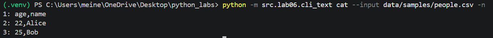
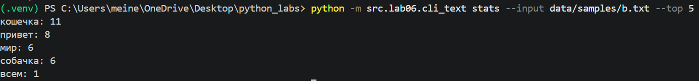
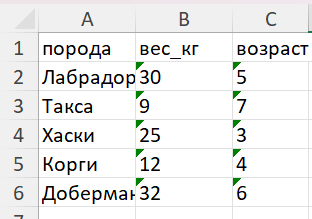

# ЛР6  CLI‑утилиты с argparse
## Задание А Подкоманды в одном CLI
``` python
def main():
    parser = argparse.ArgumentParser(description="CLI‑утилиты лабораторной №6")
    subparsers = parser.add_subparsers(dest="command")

    cat_parser = subparsers.add_parser("cat", help="Вывести содержимое файла")
    cat_parser.add_argument("--input", required=True)
    cat_parser.add_argument("-n", action="store_true", help="Нумеровать строки")

    stats_parser = subparsers.add_parser("stats", help="Частоты слов")
    stats_parser.add_argument("--input", required=True)
    stats_parser.add_argument("--top", type=int, default=5)

    args = parser.parse_args()
```
Создаем парсер и субпарсеры

``` python 
    if args.command == "cat":
        with open(args.input, encoding='UTF-8') as file_in:
            for number, line in enumerate(file_in, start=1):
                if args.n:
                    print(f"{number}: {line}", end="")
                else:
                    print(line, end="")

    elif args.command == "stats":
        with open(args.input, encoding="UTF-8") as file_in:
            rtext = file_in.read()
            text = normalize(rtext)
            tokens = tokenize(text)
            freq = count_freq(tokens)
            result = top_n(freq, args.top)
            for word, count in result:
                print(f"{word}: {count}")

if __name__ == "__main__":
    main()
```
Выполняется скрипт в зависимости от выбранной команды
### Примеры запуска
Подкоманда cat 

Подкоманда stats

## Задание Б CLI‑конвертер
``` python
def main():
    parser = argparse.ArgumentParser(description="Конвертеры данных")
    sub = parser.add_subparsers(dest="cmd")

    p1 = sub.add_parser("json2csv")
    p1.add_argument("--in", dest="input", required=True)
    p1.add_argument("--out", dest="output", required=True)

    p2 = sub.add_parser("csv2json")
    p2.add_argument("--in", dest="input", required=True)
    p2.add_argument("--out", dest="output", required=True)

    p3 = sub.add_parser("csv2xlsx")
    p3.add_argument("--in", dest="input", required=True)
    p3.add_argument("--out", dest="output", required=True)

    args = parser.parse_args()
```
создание парсера и суб парсеров

``` python
    if args.cmd == 'json2csv':
        json_to_csv(args.input, args.output)

    elif args.cmd == 'csv2json':
            csv_to_json(args.input, args.output)

    elif args.cmd == 'csv2xlsx':
            csv_to_xlsx(args.input, args.output)
```
Вызываем команды
``` python
if __name__ == '__main__':
      main()
```
Запускаем

## Примеры запуска
### json2csv
в терминале :
```
 python -m src.lab06.cli_convert json2csv --in data/samples/people.json --out data/out/people.csv                                               
```
входные данные:
``` json
[
  {"name": "Alice", "age": 22},
  {"name": "Bob", "age": 25}
]
```
Выходные данные :
```
age,name
22,Alice
25,Bob
```
### csv2json
В терминале:
```
 python -m src.lab06.cli_convert csv2json --in data/samples/cities.csv --out data/out/cities.json       
```
Входные данные:
```
name,age,city
Alice,22,SPB
Bob,25,Moscow
```
Выходные данные:
``` json
[
  {
    "name": "Alice",
    "age": "22",
    "city": "SPB"
  },
  {
    "name": "Bob",
    "age": "25",
    "city": "Moscow"
  }
]
```
### csv2xlsx
В терминале:
``` 
src.lab06.cli_convert csv2xlsx --in data/samples/dogs.csv --out data/out/dogs.xlsx
```
Входные данные:
``` 
порода,вес_кг,возраст
Лабрадор,30,5
Такса,9,7
Хаски,25,3
Корги,12,4
Доберман,32,6
```
Выходная таблица 

